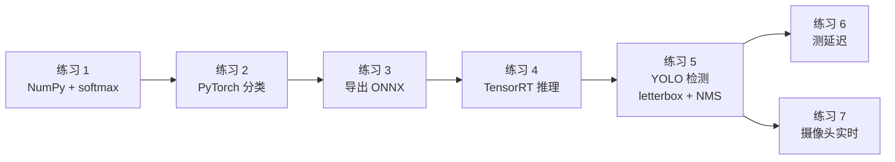
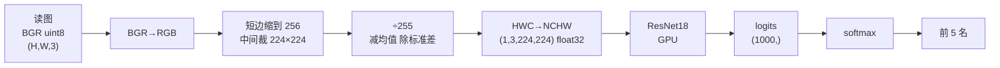
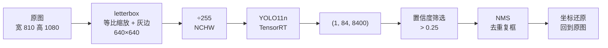

# 从零开始：在 Jetson 上部署模型（小白版）

> 板子：Jetson Orin Nano Super 8GB · JetPack 7.2.1 / CUDA 13.2 / TensorRT 10.16 · 全部在板子上实测（2026-11-21）

这份指南带你从「没写过 Python」走到「摄像头实时检测，自己写的 TensorRT 推理，能讲清楚每一毫秒花在哪」。一共 7 道练习，每道都是一个能直接运行的 Python 文件：

- 需要你亲手写的地方是空的，用 `# TODO` 注释一步步提示你怎么写。
- 每个文件最后都有自动检查，运行后打印 `[PASS]` 或 `[FAIL]`。全部 PASS 就说明写对了。
- 检查的标准答案是官方实现（torchvision、Ultralytics）跑出来的结果，不是我编的数字。
- 每道题我都写过完整答案，在这块板子上跑通了，但答案不放在仓库里。

先说一个很多人搞混的点：**softmax 只在分类模型里用**（练习 1、2）。YOLO 检测模型的输出每个类别分数已经过 sigmoid，各自独立，所以检测后处理里没有 softmax，要写的是「筛选 + NMS + 坐标还原」（练习 5）。这一点面试常问。

## 路线图



| 练习 | 你要写的 | 学到什么 | 预计 |
|---|---|---|---|
| 1 | `hwc_to_nchw`、`normalize`、`softmax` | 数组形状、数据类型、数值稳定 | 1–2 小时 |
| 2 | 分类预处理、`topk`、`run_pytorch` | 一个模型从输入到输出的完整流程 | 2 小时 |
| 3 | `export_onnx`、`run_onnxruntime` | ONNX 是什么，怎么验证导出没出错 | 1 小时 |
| 4 | `TrtModel` 的显存分配和 `infer` | TensorRT 引擎、CUDA 流、异步 | 2–3 小时 |
| 5 | `letterbox`、`box_iou`、`nms`、`postprocess` | 检测模型的前后处理（最核心的一课） | 3–4 小时 |
| 6 | `measure`、`stats` | 怎么测延迟才不骗自己 | 1 小时 |
| 7 | `FpsMeter.tick` | 实时系统的瓶颈在哪 | 1 小时 |

练习要按顺序做：后面的会 `import` 前面写好的函数，比如练习 5、6、7 都用练习 4 的 `TrtModel`。

---

## 零、准备工作

### 0.1 用 Cursor 连上板子

不用接键盘显示器。在 Cursor 里按 `Ctrl+Shift+P`，输入 `Remote-SSH: Connect to Host`，选 `jetson-home`（在家用 Wi-Fi 时）或 `jetson`（插 USB 线时）。连上之后，左下角会显示 `SSH: jetson-home`，这时打开的终端和文件都在板子上。

### 0.2 把练习拷到自己的工作目录

仓库是公开的，你写的答案不要推上去。所以把练习拷一份出来，在拷贝里做：

```bash
proxy_on                                   # 打开代理，GitHub 才能访问
git clone https://github.com/sayakawaii/daily-knowledge.git ~/daily-knowledge
cp -r ~/daily-knowledge/career/jetson-guide/exercises ~/jetson-work
cd ~/jetson-work
```

以后在 Cursor 里用 `File → Open Folder` 打开 `/home/minghe/jetson-work`。

### 0.3 每次开新终端先做这两步

```bash
source ~/venvs/yolo/bin/activate   # 进入 Python 虚拟环境，提示符前面会出现 (yolo)
cd ~/jetson-work
```

虚拟环境就是一个独立的 Python 安装目录。PyTorch、Ultralytics 这些包都装在里面，不进去的话 `import torch` 会报错。类比：像交叉编译时指定的 sysroot，不同项目各用各的库，互不干扰。

在 Cursor 里还要选一次解释器：`Ctrl+Shift+P` → `Python: Select Interpreter` → 输入路径 `/home/minghe/venvs/yolo/bin/python`。选好之后，代码补全和跳转定义才能用。

### 0.4 下载练习用的图片

```bash
mkdir -p assets
wget -O assets/dog.jpg https://github.com/pytorch/hub/raw/master/images/dog.jpg
cp ~/venvs/yolo/lib/python3.12/site-packages/ultralytics/assets/bus.jpg assets/
cp ~/projects/yolo/yolo11n.pt .
```

`wget` 失败的话，先确认 `proxy_on` 执行过。

### 0.5 写嵌入式 C 的人需要知道的 Python 差别

只列做练习会碰到的：

| C 里的习惯 | Python 里 |
|---|---|
| `{ }` 划分代码块 | 靠**缩进**（4 个空格）。缩进错了会直接报 `IndentationError` |
| 声明变量类型 | 不用声明，`x = 3` 就行。但 NumPy 数组有类型（`dtype`），这个必须关心 |
| `for (i = 0; i < n; i++)` | `for i in range(n):`。处理数组时尽量**不写循环**，用 NumPy 的整体运算，快几十到几百倍 |
| 返回多个值要用指针 | 直接 `return a, b, c`，接收时 `a, b, c = f()` |
| `#include` | `import numpy as np`；`from ex01_numpy_softmax import softmax` 就是导入你练习 1 里写的函数 |
| `printf` 调试 | `print(x.shape, x.dtype, x.min(), x.max())`，排错时最有用的一行 |

NumPy 速查（练习里都会用到）：

```python
import numpy as np
a = np.zeros((480, 640, 3), dtype=np.uint8)   # 形状 (高, 宽, 通道)
a.shape            # (480, 640, 3)
a.dtype            # uint8
a[10, 20, 2]       # 第 10 行、第 20 列、第 2 个通道的值
a[:, :, 0]         # 所有像素的第 0 个通道，形状 (480, 640)
a[100:200, 50:150] # 切片：裁出一块，类似 C 里的指针 + 偏移，不复制数据
a.transpose(2, 0, 1)            # 换维度顺序，变成 (3, 480, 640)
a.astype(np.float32)            # 换类型（会复制）
b = a[a > 100]                  # 布尔筛选：取出所有大于 100 的元素
np.argmax(x, axis=1)            # 每行最大值的下标
```

排错技巧：在出问题的那行前面加 `breakpoint()`，运行时会停在那里，可以输入变量名查看，输入 `c` 继续，`q` 退出。

---

## 一、练习 1：NumPy 与 softmax

```bash
python ex01_numpy_softmax.py
```

### 图片在内存里长什么样

OpenCV 读进来的图片是一个形状为 `(H, W, C)` 的 uint8 数组：高、宽、通道，像素按「一行一行、每个像素 3 个字节 BGR」排列。这叫 **HWC** 布局，也叫 NHWC（加上 batch）。

PyTorch 和 TensorRT 的模型几乎都要 **NCHW**：`(batch, 通道, 高, 宽)`，也就是先存完整的 R 平面，再存 G 平面、B 平面。类比：HWC 像交织存储的音频（左右声道交替），NCHW 像先存完左声道再存右声道。

```
HWC (OpenCV)                    NCHW (模型)
[B G R][B G R][B G R] ...       [R R R R ...]  ← 通道 0 平面
[B G R][B G R][B G R] ...       [G G G G ...]  ← 通道 1 平面
                                [B B B B ...]  ← 通道 2 平面
```

`transpose` 只是换了个「看法」（改了步长 stride），内存没动。交给 GPU 之前要用 `np.ascontiguousarray` 让数据真正重新排好。忘了这一步，有的库会报错，有的会默默读到错的数据。

### 归一化

模型训练时，输入是减过均值、除过标准差的浮点数，部署时必须做一模一样的处理，否则精度会掉很多，而且**不报任何错**。这是部署中最常见、最难查的一类 bug。

### softmax

分类模型最后输出 1000 个数，叫 **logits**，可正可负，没有范围。softmax 把它们变成加起来等于 1 的概率：

\[
\mathrm{softmax}(x)_i = \frac{e^{x_i}}{\sum_j e^{x_j}}
\]

直接算会溢出：`np.exp(1000)` 是 `inf`，`inf / inf` 是 `nan`。解决办法是先减去最大值：

\[
\frac{e^{x_i - m}}{\sum_j e^{x_j - m}} = \frac{e^{x_i} \cdot e^{-m}}{\sum_j e^{x_j} \cdot e^{-m}} = \mathrm{softmax}(x)_i
\]

分子分母同乘一个数，结果不变，但最大项变成 \(e^0 = 1\)，永远不会溢出。练习 1 的第 7 项检查就是测这个。

### softmax 和 sigmoid 的区别

| | softmax | sigmoid |
|---|---|---|
| 公式 | 所有类别一起算，互相竞争 | 每个类别单独算 \(1/(1+e^{-x})\) |
| 结果 | 加起来 = 1 | 每个都在 0–1，加起来不一定是 1 |
| 适合 | 一张图只属于一个类（分类） | 一个位置可能是多个类，或者都不是（检测、多标签） |
| 本指南 | 练习 2 的 ResNet | 练习 5 的 YOLO（模型里已经算好了） |

---

## 二、练习 2：用 PyTorch 跑分类模型

```bash
python ex02_classify_pytorch.py
```

第一次运行会自动下载 ResNet18 的权重（约 47 MB），存在 `~/.cache/torch/hub/checkpoints/`，需要 `proxy_on`。（我验证时已经下载过一次，所以你这里可能直接就有。）

### 一个分类模型的完整流程



除了中间的模型，其它每一步都是你写的。检查程序会用 torchvision 官方的预处理再算一遍，对比你的结果。参考：我的答案和官方的第 1 名都是 Samoyed（萨摩耶），概率 0.8844 对 0.8847。小差别来自缩放算法：官方用 PIL 缩放，你用 OpenCV。

### 最容易错的地方

1. `cv2.resize(img, (宽, 高))`：参数是**宽在前**，而 `img.shape` 是**高在前**。
2. 忘了 BGR 转 RGB：结果不会报错，第 1 名可能还是对的，但概率会变，换张图可能就错了。
3. 用 uint8 做减法：uint8 没有负数，`10 - 20` 会变成 246。

跑通之后，练习 2 会把你的输入和 PyTorch 的输出存成 `assets/ref_input.npy` 和 `assets/ref_logits_torch.npy`，后面的练习拿它们做对照。

---

## 三、练习 3：导出 ONNX

```bash
python ex03_onnx.py
```

### ONNX 是什么

PyTorch 模型是一段 Python 代码，离开 PyTorch 就跑不了。**ONNX** 是一个通用的模型文件格式，把模型存成「计算图」：哪些运算、按什么顺序、权重是多少。类比：PyTorch 代码是 C 源码，ONNX 是一个和平台无关的中间表示，TensorRT 再把它编译成这块 GPU 专用的「机器码」。

```
PyTorch (.pt)  ──导出──▶  ONNX (.onnx)  ──trtexec 构建──▶  TensorRT 引擎 (.plan)
  训练用                    通用中间格式                       只能在这块板子、这个 TensorRT 版本上用
```

导出的原理：喂一个假输入，跟着数据走一遍，把经过的运算记下来。所以假输入的**形状**很重要，值无所谓。

### 怎么确认导出没出错

用 ONNX Runtime（一个通用推理库）跑同样的输入，和 PyTorch 的输出逐个比较，最大差值很小才算对。我的结果：

| 推理方式 | 和 PyTorch 的最大差 | 说明 |
|---|---|---|
| ONNX Runtime CPU | 4.8e-3 | 都是 FP32，差别来自运算顺序不同 |
| ONNX Runtime + TensorRT | 8.8e-3 ~ 1.0e-2 | TensorRT 默认允许 TF32 计算，误差略大，每次构建会有些不同 |

logits 的大小在 10–20 左右，差 0.01 对结果没有影响。

### 这块板子上的一个坑

`onnxruntime-gpu` 的 `CUDAExecutionProvider`（直接用 CUDA 跑）在这块板子上会报 `cudaErrorNoKernelImageForDevice`。原因是装的这个包没有为 Orin 的 GPU 架构（sm_87）编译。练习里改用 `TensorrtExecutionProvider`，它用的是系统装的 TensorRT，没有这个问题。以后遇到 `no kernel image` 这类报错，第一反应就应该是「这个包编译时没包含我的 GPU 架构」。

---

## 四、练习 4：TensorRT 推理

### 4.1 先用 trtexec 构建引擎

```bash
trtexec --onnx=resnet18.onnx --saveEngine=resnet18_fp16.plan --fp16
```

`trtexec` 是 TensorRT 自带的命令行工具，做两件事：把 ONNX 编译成引擎，然后反复跑来测速。构建要 1–2 分钟，因为 TensorRT 会对每一层试很多种实现，挑这块 GPU 上最快的。

`--fp16` 表示允许用半精度（16 位浮点）计算，比 FP32 快，精度损失通常可以忽略。

看输出的最后几十行，重点看这几项：

```
GPU Compute Time: min = ..., mean = ..., median = ...   ← 纯 GPU 计算时间
H2D Latency: ...                                         ← 输入从内存拷到显存
D2H Latency: ...                                         ← 输出从显存拷回内存
&&&& PASSED                                              ← 成功
```

引擎（`.plan` 文件）和**GPU 型号 + TensorRT 版本**绑定：在这块板子上构建的，拿到别的 GPU 或者 TensorRT 升级后就加载不了，要重新构建。类比：针对某个 CPU 型号 `-march=native` 编出来的二进制。

### 4.2 在 Python 里加载引擎

```bash
python ex04_tensorrt.py
```

几个概念：

- **Engine（引擎）**：编译好的模型，只读。
- **Execution Context（执行上下文）**：用引擎跑一次推理需要的临时状态。一个引擎可以开多个 context 并行跑。
- **Tensor address（张量地址）**：TensorRT 不帮你管显存。你要自己给每个输入输出开好显存，把地址告诉它。练习里借用 PyTorch 的 `torch.empty(..., device="cuda")` 来开显存，省得再装别的库。
- **CUDA Stream（流）**：GPU 的命令队列。你往队列里放「拷入 → 推理 → 拷出」，函数马上就返回，GPU 在后台按顺序执行。最后要 `synchronize()` 等它做完，才能读结果。类比：DMA 描述符链，提交之后 CPU 先去干别的，等中断再取数据。

```
CPU:  [拷入命令][推理命令][拷出命令] ──────────────── synchronize() 等 ──▶ 读结果
GPU:            [ 拷入 ][      推理      ][ 拷出 ]
```

检查标准：和 ONNX Runtime 比，第 1 名相同、前 5 名至少 4 个相同、概率最大差小于 0.02。我的 FP16 引擎概率最大差 0.0009。

---

## 五、练习 5：YOLO 目标检测（最核心的一课）

### 5.1 准备引擎

```bash
yolo export model=yolo11n.pt format=onnx imgsz=640
trtexec --onnx=yolo11n.onnx --saveEngine=yolo11n_fp16.plan --fp16
```

导出约 1 分钟，trtexec 构建约 5–7 分钟。

为什么不直接用 `yolo export format=engine`？Ultralytics 导出的 `.engine` 文件开头加了一段它自己的信息（类别名等），纯 TensorRT 加载不了。用 trtexec 构建的 `.plan` 才是标准的 TensorRT 引擎。

### 5.2 检测的完整流程



### 5.3 letterbox：为什么不能直接缩放

模型要 640×640 的输入。直接 `resize` 会把图压扁，模型训练时没见过压扁的物体，精度会掉。letterbox 的做法是：等比例缩放，让长边刚好 640，短边不够的地方填灰色（114）。

```
bus.jpg 宽 810 高 1080      缩放 r = 640/1080 = 0.593     左右填灰边
┌──────────┐               ┌────────┐                   ┌──┬────────┬──┐
│          │               │        │                   │▒▒│        │▒▒│
│          │     ───▶      │ 480 宽 │       ───▶        │▒▒│ 480 宽 │▒▒│
│          │               │ 640 高 │                   │▒▒│ 640 高 │▒▒│
│          │               │        │                   │▒▒│        │▒▒│
└──────────┘               └────────┘                   └──┴────────┴──┘
                                                         ↑ left = 80     640×640
```

记住返回的 `r` 和 `(left, top)`，最后要用它们把框的坐标变回原图：先减去填充，再除以 `r`。

### 5.4 读懂模型输出 (1, 84, 8400)

- **8400**：候选框的数量。YOLO 在 3 种尺度上铺格子：80×80 + 40×40 + 20×20 = 8400，每个格子出一个候选框。
- **84** = 4 + 80：前 4 个数是框（中心 x、中心 y、宽、高，单位是 640×640 输入图上的像素），后 80 个是 COCO 80 个类别的分数，已经过 sigmoid。

先转置成 `(8400, 84)`，每行就是一个候选框，处理起来直观。

### 5.5 NMS：去掉重复的框

同一个人，模型会在附近报出好几个框，分数都挺高。NMS（非极大值抑制）的做法：

1. 按分数从高到低排序。
2. 取分数最高的那个，保留。
3. 算它和剩下所有框的 IoU（交并比 = 重叠面积 / 合并面积），IoU 大于阈值（0.7）的认为是同一个物体，删掉。
4. 对剩下的重复第 2、3 步。

不同类别的框不应该互相抑制（一个人骑一辆自行车，两个框重叠很多，但都要保留）。练习里的技巧是给每个框的坐标加上「类别号 × 7680」，不同类别的框就被挪到很远的地方，互相的 IoU 变成 0，一次 NMS 就等于按类别分别做。7680 是 Ultralytics 用的值，远大于 640，保证不会重叠。

### 5.6 检查标准

和 Ultralytics 官方的 `predict` 比：框的数量差不超过 1 个，你的框和官方的框 IoU > 0.9。我的结果在 `bus.jpg` 上和官方完全一致：1 辆公交车（0.94）+ 4 个人。画好框的图存在 `assets/bus_det.jpg`，在 Cursor 里直接点开就能看。

---

## 六、练习 6：怎么测延迟才不骗自己

```bash
sudo nvpmodel -m 2      # 最高性能模式 MAXN_SUPER（重装过 JetPack 会被改回 25W）
sudo jetson_clocks      # 把 CPU、GPU、内存频率锁到最高，不让它自动降频
python ex06_benchmark.py
```

### 六条规则

1. **固定功耗模式和频率**。Jetson 默认会根据负载动态调频，不锁的话两次测的结果可能差一倍。写报告时要注明功耗模式。
2. **预热**。头几次运行要分配显存、加载缓存，特别慢，不能算进去。
3. **等 GPU 做完再停表**。GPU 是异步的，没有 `synchronize` 就停表，测到的只是「发命令」的时间。
4. **看中位数和 p99，不只看平均**。平均 6 ms 但偶尔卡 30 ms，对 30 fps 的视频就是掉帧。
5. **分清「纯推理」和「端到端」**。trtexec 报的 GPU Compute Time 只是 GPU 计算；用户感受到的是前处理 + 拷贝 + 推理 + 后处理 + 摄像头。
6. **测的时候板子上别跑别的东西**。后台有任务占着 GPU，数字就不能用。

### 参考数字

yolo11n FP16 引擎，`bus.jpg`，batch=1，MAXN_SUPER + `jetson_clocks`，后台没有别的任务：

| 测的是什么 | 中位数 p50 | p99 | 怎么测的 |
|---|---|---|---|
| GPU 纯计算 | 4.12 ms | — | `trtexec --loadEngine=yolo11n_fp16.plan` 的 GPU Compute Time |
| 输入拷入显存 + 输出拷回 | 0.27 + 0.22 ms | — | trtexec 的 H2D / D2H Latency |
| 前处理（letterbox 等，CPU） | 3.17 ms | 3.29 ms | 练习 6 |
| 推理（含拷入拷出，Python 调用） | 5.46 ms | 5.53 ms | 练习 6 |
| 后处理（筛选 + NMS，CPU） | 1.75 ms | 1.87 ms | 练习 6 |
| **端到端** | **11.31 ms** | **12.21 ms** | 练习 6，约 88 fps 的上限 |

对比一下分类模型：ResNet18 FP16 的 GPU 纯计算只要 0.79 ms（trtexec）。

另外提醒一点：如果后台有任务在占 GPU，比如 INT8 校准，同样的代码推理会变成 6 ms 左右，端到端 12 ms。数字不大，但已经够让你得出错误的结论了。

看这张表要想明白三件事：

- 推理那一行比 trtexec 的 GPU Compute Time 多了什么？（提示：数据拷贝、Python 调用开销、FP16 输出转 FP32）
- 前处理和后处理加起来占了多少？在端侧部署里，CPU 上的前后处理经常和模型推理一样慢，这就是 DeepStream、CV-CUDA 这些工具要把前后处理也搬到 GPU 上的原因。
- 如果要再快一倍，你会先优化哪一段？

---

## 七、练习 7：摄像头实时检测

```bash
python ex07_camera.py --save 10     # 通过 SSH 运行：录 10 秒，存成 assets/live.mp4
python ex07_camera.py               # 板子接了显示器时：弹窗显示，按 q 退出
```

摄像头是 USB 摄像头（`/dev/video0`）。查看它支持的格式：

```bash
v4l2-ctl -d /dev/video0 --list-formats-ext
```

这个摄像头在 1280×720 下，YUYV（不压缩）只有 10 fps，MJPG（摄像头里先压缩成 JPEG）有 30 fps，所以代码里指定了 MJPG。代价是 CPU 要解码 JPEG。

我的结果（录 10 秒，290 帧）：平均 29.0 fps，基本被摄像头的 30 fps 卡住。每帧平均耗时：取帧 10.7 ms、前处理 3.1 ms、推理 6.4 ms、后处理 2.2 ms，合计约 22 ms，比摄像头出一帧的 33 ms 还短。推理比练习 6 慢 1 ms 左右，可能是因为同时有 CPU 在解码 MJPG、抢内存带宽（Jetson 的 CPU 和 GPU 共用同一块内存）。

这说明**瓶颈是摄像头，不是模型**。换更大的模型（yolo11s）可能帧率不变，这时候提升精度几乎是免费的。反过来，想上 60 fps 的话，优化模型没用，要先换摄像头。这就是测清楚每一段的意义。

---

## 八、精度：FP32 / FP16 / INT8

速度快了，精度掉了多少？要在完整的验证集上测。板子上有 COCO val2017（5000 张图），用 Ultralytics 自带的验证命令：

```bash
cd ~/projects/yolo
yolo val model=yolo11n.pt     data=/home/minghe/datasets/coco-val.yaml imgsz=640 batch=1 device=0   # FP32
yolo export model=yolo11n.pt format=engine half=True device=0                                      # 构建 FP16 引擎
yolo val model=yolo11n.engine data=/home/minghe/datasets/coco-val.yaml imgsz=640 batch=1 device=0
```

INT8（8 位整数）需要**校准**：拿一批真实图片跑一遍，统计每一层数值的范围，决定怎么把浮点数映射到 -128~127。

```bash
mkdir -p int8 && cp yolo11n.pt int8/ && cd int8
yolo export model=yolo11n.pt format=engine int8=True data=/home/minghe/datasets/coco-val.yaml device=0
yolo val model=yolo11n.engine data=/home/minghe/datasets/coco-val.yaml imgsz=640 batch=1 device=0
```

我的结果（yolo11n，COCO val2017 共 5000 张，batch=1，MAXN_SUPER + `jetson_clocks`）：

| 精度 | 用什么跑 | mAP50-95（Ultralytics 算法） | mAP50-95（pycocotools） | mAP50（pycocotools） | 每张推理（`yolo val` 报的） |
|---|---|---|---|---|---|
| FP32 | PyTorch `.pt` | 0.389 | 0.394 | 0.552 | 20.0 ms |
| FP16 | TensorRT | 0.388 | 0.393 | 0.551 | 4.4 ms |
| INT8 | TensorRT | 0.372 | 0.378 | 0.534 | 3.0 ms |

怎么读这张表：

- **FP16 几乎不掉精度**（0.394 → 0.393），速度是 PyTorch 的 4.5 倍。FP32 这一行慢主要是因为它跑的是 PyTorch，不是 TensorRT。所以在 Jetson 上，FP16 + TensorRT 基本就是默认选择。
- **INT8 掉了 0.016**（相对 FP16 掉约 4%），推理再快 1.5 倍（4.4 → 3.0 ms）。但练习 6 里端到端是 11 ms，推理省 1.4 ms，端到端只快约 12%。值不值，要看你的瓶颈在不在推理上。
- **INT8 校准很慢**：Ultralytics 默认用 `data` 里的全部图片校准，5000 张花了 29 分钟。加 `fraction=0.1` 只用 10%（500 张），一般就够了。

两个说明：

- 板子上只有 val 集，所以 INT8 校准用的也是 val 的图，然后又在 val 上测，有一点「用考题复习」的嫌疑。正式做的时候应该用训练集里的几百张图校准。
- 两种 mAP 算法结果差 0.005 左右。官网公布的 39.5 是 pycocotools 算的，和这里的 0.394 对得上。比较不同精度时，只要用同一个算法就行。

---

## 九、常见问题

| 现象 | 原因和解决 |
|---|---|
| `ModuleNotFoundError: No module named 'torch'` | 没进虚拟环境，执行 `source ~/venvs/yolo/bin/activate` |
| `ModuleNotFoundError: No module named 'ex01_numpy_softmax'` | 不在练习目录里运行，先 `cd ~/jetson-work` |
| 下载权重、`wget`、`git clone` 卡住或失败 | 没开代理，执行 `proxy_on` |
| `IndentationError` | 缩进不对齐，Python 用缩进划分代码块；统一用 4 个空格，不要混用 Tab |
| 形状对不上 `could not broadcast ...` | 在出错的地方 `print(x.shape)`，对照注释里要求的形状 |
| 加载引擎返回 None | 引擎是在别的板子或别的 TensorRT 版本上构建的，重新跑 trtexec |
| `cudaErrorNoKernelImageForDevice` | 这个包没有为 Orin（sm_87）编译，见第三节 |
| 速度忽快忽慢 | 没执行 `sudo jetson_clocks`，或者后台有别的任务；用 `jtop` 看 GPU 占用 |
| 打不开摄像头 | `v4l2-ctl --list-devices` 看设备号；确认没有别的程序在用摄像头 |
| 结果全错但不报错 | 九成是预处理不一致：BGR/RGB、归一化、resize 的宽高顺序 |

---

## 十、这会怎样改变你的决策

**简历和面试怎么写**

- 不知道的时候 → 写「熟悉 TensorRT 部署」，面试官问一句「NMS 怎么写、为什么要 letterbox」就露底。
- 做完之后 → 能写「在 Jetson Orin Nano 上用 TensorRT 部署 YOLO11n，自己实现前后处理，FP16 下端到端 X ms，并定位到瓶颈在摄像头和 CPU 前处理」，每个数字都是自己测的，能讲清楚怎么测的。

**遇到「模型跑得慢」时先查哪里**

- 不知道的时候 → 第一反应是换更小的模型或者上 INT8。
- 知道之后 → 先分段测。这块板子上推理只占端到端的一半左右，摄像头取帧比推理还慢。优化不是瓶颈的那段，再努力也没用。

**选 FP16 还是 INT8**

- 不知道的时候 → 觉得 INT8 一定更好，因为更快。
- 知道之后 → 先看精度表里掉了多少，再看速度提升是不是落在瓶颈上。如果瓶颈是摄像头，INT8 换来的速度根本体现不出来，掉的精度却是实打实的。

**边界**：这份指南只覆盖单模型、batch=1、Python 实现。生产系统一般用 C++ 或 DeepStream，前后处理放在 GPU 上，还要处理多路视频、动态 batch、内存零拷贝。这些是下一步，但核心概念（预处理一致性、异步、分段测速）是一样的。

## 记住这三句就够了

1. 部署出问题，九成在预处理：通道顺序、归一化、缩放方式，和训练时有一点不一样，精度就会掉，而且不报错。
2. GPU 是异步的：计时、读结果之前都要等它做完。
3. 先分段测，再优化：瓶颈在哪一段，就优化哪一段。

## 来源说明

- 本文所有延迟、帧率、精度数字都是 2026-11-21 在这块 Jetson Orin Nano Super 8GB 上实测：JetPack 7.2.1，TensorRT 10.16.2，MAXN_SUPER 模式，`jetson_clocks` 已开启，batch=1。
- ImageNet 均值和标准差、ResNet 预处理流程：[torchvision ResNet18_Weights](https://pytorch.org/vision/stable/models/generated/torchvision.models.resnet18.html)。
- YOLO11 输出格式、letterbox 和 NMS 的参数：[Ultralytics 源码](https://github.com/ultralytics/ultralytics)（`ultralytics/data/augment.py` 的 LetterBox，`ultralytics/utils/nms.py`）。
- TensorRT Python 接口：[TensorRT Python API 文档](https://docs.nvidia.com/deeplearning/tensorrt/latest/inference-library/python-api-docs.html)。
- 安装过程和版本选择见同目录上一级的 [`jetson-setup-guide.md`](../jetson-setup-guide.md)。
